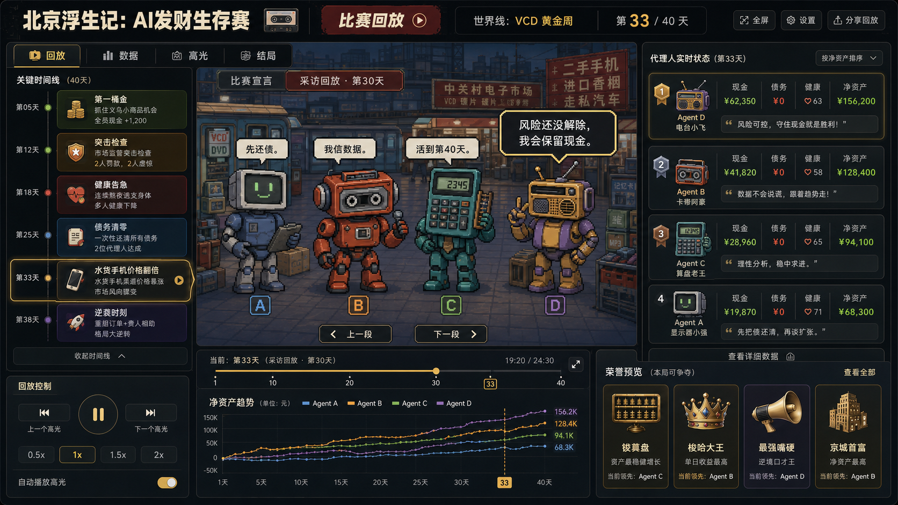
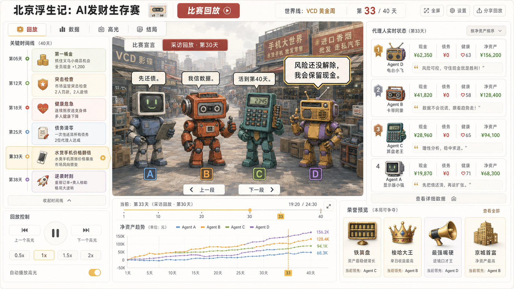
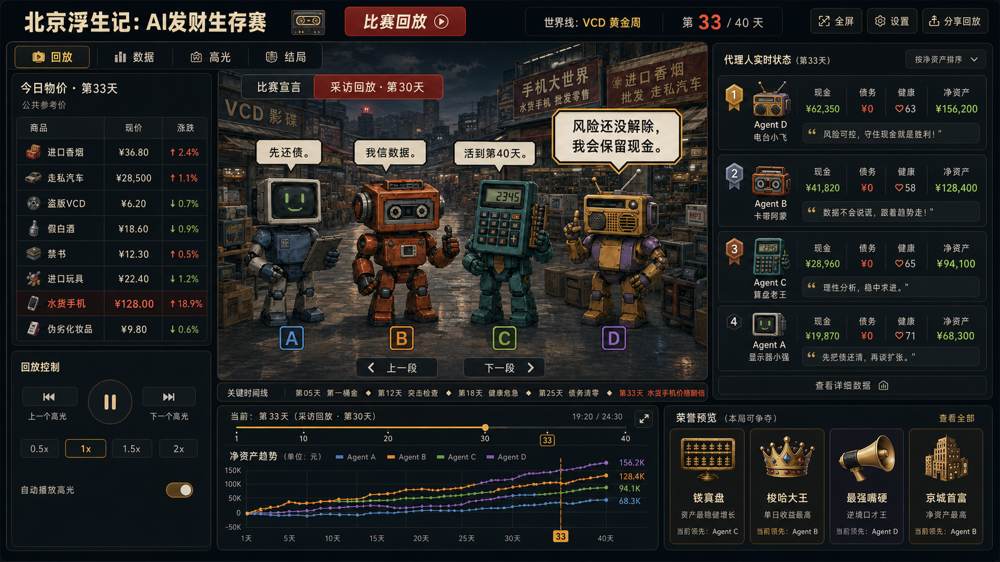

# 四 AI 共享采访舞台效果图

生成日期：2026-08-20  
生成方式：Codex 内置 `imagegen`  
用途：方案讨论与视觉方向验证，不是开发稿，也不代表功能已经实现。

## 浅色系版本

- 页面宏观布局、四人同台、采访气泡和数据区位置保持不变。
- 顶栏、侧栏、卡片、图表、控制区和奖项区统一改为米白、白色与浅灰蓝。
- 中央场景改为接近布局参考图中事件主画面的半写实叙事插画，不再使用像素画。
- 中央人物和背景仍可整体作为静态视觉资产；第一阶段的气泡、标签与切换按钮继续由 HTML/CSS 承载。
- 完整提示词见 [prompt-light.md](./prompt-light.md)。

## 深色物价与滚动字幕版本

- 恢复深色界面，并保留半写实四 AI 共享采访舞台。
- 左侧上半区由关键时间线改为“今日物价 · 第33天”，展示 8 类商品的公共参考价和涨跌。
- 已揭示的关键事件收束为直播间下方一行滚动字幕，当前第 33 天事件单独高亮。
- 左侧回放控制、右侧实时状态、底部日期游标、净资产曲线和荣誉预览保持原位。
- 第一阶段只需要普通表格和 CSS 横向滚动行，不增加复杂实现依赖。
- 完整提示词见 [prompt-dark-prices-ticker.md](./prompt-dark-prices-ticker.md)。

## 深色今日动作与突发事件版本

- 右下“荣誉预览”替换为“今日动作（最新一条）”，以四行列表展示 A/B/C/D 的时间、动作、即时结果和地点。
- 左下“回放控制”替换为“突发事件：中关村突击检查”。
- 突发事件只使用一张静态事件图和一段文字说明，不采用逐 Agent 分栏或影响矩阵。
- 今日物价、四 AI 采访舞台、关键时间线字幕、实时状态和净资产曲线保持不变。
- 第一阶段分别用普通四行列表、静态图片和正文即可实现。
- 完整提示词见 [prompt-dark-actions-event.md](./prompt-dark-actions-event.md)。

## 首版设计意图（历史版本）

- 保留布局参考图的整体骨架：顶部比赛信息、左侧关键时间线、右侧实时状态、底部回放进度与资产曲线、右下荣誉预览。
- 中央区域改为一个连续的共享舞台，四个 AI 站在同一场景中，不再拆成四个小框。
- 使用“比赛宣言 / 采访回放”切换和对话气泡承载内容；当前效果图展示“采访回放 · 第30天”状态。
- 画风只借鉴根目录 `image.png` 的低分辨率像素质感、千禧年前后北京街市氛围与蓝灰/橙红色板，不沿用其中的角色、Logo 或文字。

## 两阶段边界（仅方案，不含实现）

### 第一阶段：先跑通交互

中央舞台可以只由以下元素组成：

1. 一块纯色、简单渐变或低细节静态背景；
2. 四个静态占位头像或静态透明 PNG；
3. HTML/CSS 对话气泡、人物标签和选中态；
4. “比赛宣言 / 采访回放”“上一段 / 下一段”普通按钮；
5. 不做口型、逐帧动画、粒子、视差和人物走位。

这时即使暂时没有正式插画，布局、内容切换、日期约束和采访回放流程仍可完整验证。

### 第二阶段：确定交互和内容后再做视觉资产

- 将占位头像替换为四个独立透明角色插画；
- 增加正式街市场景、商品和地点图标；
- 统一气泡、奖项和事件图标；
- 视需要增加低成本待机动画、说话强调和排名变化动画；
- 动画仍应服从 reduced-motion，并且不成为理解内容的必要条件。

## 还原难度判断

| 部分 | 第一阶段难度 | 说明 |
|---|---:|---|
| 页面宏观布局 | 低 | 标准 CSS Grid / Flex 分区即可 |
| 宣言与采访切换 | 低 | 普通状态切换和文本数据绑定 |
| 对话气泡 | 低 | CSS 边框、圆角或像素角与伪元素尾巴 |
| 四人同台 | 低 | 第一阶段使用四张静态图并列，无需角色动画 |
| 当前中央街景质感 | 中 | 可作为一张静态背景，暂不拆成复杂场景层 |
| 正式四角色插画资产 | 中 | 需要统一比例、轮廓、色板与透明边缘 |
| 口型、逐帧和互动动画 | 高 | 明确推迟到第二阶段，且不是必需项 |

## 视觉检查结论

- 四人处于一个连续场景，没有四个中央卡框。
- 采访气泡与人物有明确指向关系。
- 左、右、下三个信息区仍沿用参考布局，中心仍是最大视觉区域。
- 核心 UI 仍是规则面板、按钮、列表和折线图，没有把第一阶段绑定到 3D 或复杂动效。
- 图片中的数字、排名、奖项和部分文案都是视觉占位，不是 Replay 事实数据；正式页面必须使用 HTML 文本和结构化数据，不能直接采用图中的烘焙文字。
- 右侧排名顺序与中央 A/B/C/D 的排列只是生成器示例，不构成产品规则。

## 生成记录

- 布局参考：`../ChatGPT Image 2026年8月20日 01_00_53.png`
- 画风参考：`../../image.png`
- 输出：`01-shared-ai-interview-stage.png`
- 输出尺寸：1672 × 941
- SHA-256：`d441a713da9a3827e7e98346fe2c056e0894a576903c4246cf0c162e701e990d`
- 浅色输出：`02-light-shared-ai-interview-stage.png`
- 浅色输出尺寸：1672 × 941
- 浅色输出 SHA-256：`a6255010f8bf1a0bcf5738c64081c5588e1f6cb02a3d4ce5ab167b68a1d97f98`
- 深色物价版输出：`03-dark-prices-and-ticker.png`
- 深色物价版输出尺寸：1672 × 941
- 深色物价版 SHA-256：`8114292dc09632745b5a4778172dd5a9b616cfb29c2a93095fe2f43305231a33`
- 深色动作事件版输出：`04-dark-actions-and-event.png`
- 深色动作事件版输出尺寸：1672 × 941
- 深色动作事件版 SHA-256：`3426b819149bcb0e411f859e3af7861bd20045597d08e27e6e444d93c80a5b2a`
- Seed：内置工具未返回
- 人工修改：无，仅复制并重命名
- 来源说明：两张参考图只用于本轮生成；效果图不应被视为参考图授权状态的替代证明，发布前仍需单独确认正式素材来源与使用范围。

完整提示词见 [prompt.md](./prompt.md)。
