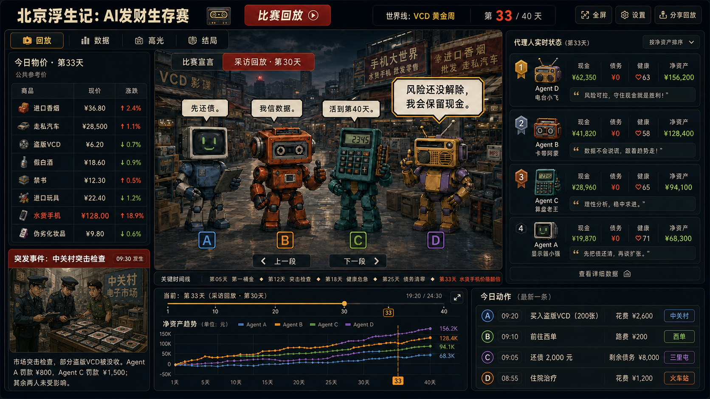

# 北京浮生记 Arena 当前视觉方向

> 状态：已确认
>
> 确认日期：2026-08-21
>
> 当前视觉基准：`04-dark-actions-and-event.png`
>
> 适用范围：本页确认视觉风格、页面骨架和信息层级。当前基准图仍是四位 A/B/C/D 的历史概念图；修订后的 P0 目标是五个中性模型同场，身份只显示 `Provider + Model`。图片中的人数、角色、示例数据和功能文案不是正式 Replay 事实，也不代表相应功能已经实现。

## 当前确认方案：深色今日动作与突发事件版本

- 使用深色、低饱和背景与橙红/金色强调色，保留千禧年前后北京街市的市井氛围。
- 页面采用明确的左、中、右、下分区：左侧物价与突发事件，中央共享舞台，右侧实时状态，底部日期时间线、净资产曲线与今日动作。五模型实现需要在不放弃该骨架的前提下重新验证信息密度。
- 右下“荣誉预览”替换为“今日动作”。新版目标按五个 `Provider + Model` 展示当日事实动作、即时结果和地点，不使用 A/B/C/D 或策略化名称。
- 左下“回放控制”替换为“突发事件：中关村突击检查”。
- 突发事件只使用一张静态事件图和一段文字说明，不采用逐 Agent 分栏或影响矩阵。
- 今日物价、共享舞台、关键时间线字幕、实时状态和净资产曲线保持不变。P0 中央区只承载事实状态；采访等派生内容到 P0.5 Replay Enrichment 才启用。
- 第一阶段分别用普通五行列表、静态图片和正文即可实现。
- 完整提示词见 [prompt-dark-actions-event.md](./prompt-dark-actions-event.md)。

确认的是这套视觉骨架，而不是图中四位角色的具体构图。P0 只实现五模型事实 Replay；采访、导演高光、奖项等进入 P0.5 独立 Replay Enrichment，未生成时必须隐藏，不能使用模拟内容占位。具体范围仍以[项目进度台账](../../docs/project-status.md)为准。

## 历史探索方向（不再作为并列候选）

以下版本保留为演进记录和素材来源，不再与 `04-dark-actions-and-event.png` 并列作为当前实现方向：

- [`01-shared-ai-interview-stage.png`](./01-shared-ai-interview-stage.png)：最初的四 AI 共享采访舞台探索；完整提示词见 [prompt.md](./prompt.md)。
- [`02-light-shared-ai-interview-stage.png`](./02-light-shared-ai-interview-stage.png)：浅色视觉探索，当前不采用；完整提示词见 [prompt-light.md](./prompt-light.md)。
- [`03-dark-prices-and-ticker.png`](./03-dark-prices-and-ticker.png)：加入今日物价与滚动字幕的中间版本；完整提示词见 [prompt-dark-prices-ticker.md](./prompt-dark-prices-ticker.md)。

## 当前视觉基准的设计原则

- 保留布局参考图的整体骨架：顶部比赛信息、左侧物价与突发事件、右侧实时状态、底部回放进度与资产曲线、右下今日动作。
- 中央区域保持一个连续的共享舞台；新版目标容纳五个中性模型，不拆成五个孤立小框。当前图片只有四位，因此实现时应以布局原则而不是像素级人数还原为准。
- 中央舞台在 P0 优先承载五个模型的同场事实状态。只有 P0.5 存在经过验证的采访或发言数据时，才使用切换和对话气泡；派生内容不得影响 Runner 或事实 Replay。
- 参赛者标签只显示 `Provider + Model`，不显示 A/B/C/D、策略 persona 或娱乐化角色名。
- 画风只借鉴根目录 `image.png` 的低分辨率像素质感、千禧年前后北京街市氛围与蓝灰/橙红色板，不沿用其中的角色、Logo 或文字。

## 两阶段实现边界

### 第一阶段：先跑通交互

中央舞台可以只由以下元素组成：

1. 一块纯色、简单渐变或低细节静态背景；
2. 五个中性身份色块、纹理或抽象 SVG 标记，不使用人格头像；
3. HTML/CSS 事实详情提示、`Provider + Model` 标签和选中态；对话气泡留到 P0.5；
4. P0 使用事实详情切换按钮；“采访回放”等控件只在 P0.5 有真实派生数据时出现；
5. 不做口型、逐帧动画、粒子、视差和人物走位。

这时即使暂时没有正式插画，宏观布局、日期约束、Agent 状态和事实回放流程仍可完整验证。

P0.5 的派生视觉必须读取独立 Replay Enrichment 产物。通用 Enrichment 使用与五个 Runner `Provider + Model` 组合均不重复的第六模型配置；赛后采访调用选手原模型时也只能读取该选手截至采访日已经发生的事实。派生内容、采访和历史轮次结果不得进入 Runner 或后续比赛上下文。

### 第二阶段：确定交互和内容后再做视觉资产

- 将占位身份标记细化为五套稳定的颜色、纹理与抽象 SVG，不把角色人格绑定到模型；
- 增加正式街市场景、商品和地点图标；
- 统一气泡、奖项和事件图标；
- 视需要增加低成本待机动画、说话强调和排名变化动画；
- 动画仍应服从 reduced-motion，并且不成为理解内容的必要条件。

## 还原难度判断

| 部分 | 第一阶段难度 | 说明 |
|---|---:|---|
| 页面宏观布局 | 低 | 标准 CSS Grid / Flex 分区即可 |
| 事实详情切换 | 低 | P0 使用普通状态切换和事实文本绑定 |
| P0.5 采访气泡 | 低 | 仅在有真实 Enrichment 数据时使用 CSS 气泡 |
| 五模型同台 | 中 | 当前参考图只有四位；第一阶段使用五张中性静态图并列，并验证 1366×768 信息密度 |
| 当前中央街景质感 | 中 | 可作为一张静态背景，暂不拆成复杂场景层 |
| 正式五模型身份标记 | 低 | 使用统一规格的颜色、纹理与抽象 SVG，不用人格形象暗示策略 |
| 口型、逐帧和互动动画 | 高 | 明确推迟到第二阶段，且不是必需项 |

## 视觉检查结论

- 当前图中的四位处于一个连续场景，没有四个中央卡框；新版实现需验证五模型同场仍保持该连续性。
- P0.5 启用采访时，气泡与模型必须有明确指向关系；P0 不显示模拟采访。
- 左、右、下三个信息区仍沿用参考布局，中心仍是最大视觉区域。
- 核心 UI 仍是规则面板、按钮、列表和折线图，没有把第一阶段绑定到 3D 或复杂动效。
- 图片中的数字、排名、奖项和部分文案都是视觉占位，不是 Replay 事实数据；正式页面必须使用 HTML 文本和结构化数据，不能直接采用图中的烘焙文字。
- 右侧排名顺序与中央 A/B/C/D 的排列只是历史生成器示例，不构成产品规则；新版 UI 只显示 `Provider + Model`。

## 生成记录

- 当前确认输出：`04-dark-actions-and-event.png`
- 当前方向确认日期：2026-08-21
- 布局参考：`../ChatGPT Image 2026年8月20日 01_00_53.png`
- 画风参考：`../../image.png`
- 输出：`01-shared-ai-interview-stage.png`
- 输出尺寸：1672 × 941
- SHA-256：`d441a713da9a3827e7e98346fe2c056e0894a576903c4246cf0c162e701e990d`
- 浅色输出：`02-light-shared-ai-interview-stage.png`
- 浅色输出尺寸：1672 × 941
- 浅色输出 SHA-256：`a6255010f8bf1a0bcf5738c64081c5588e1f6cb02a3d4ce5ab167b68a1d97f98`
- 深色物价版输出：`03-dark-prices-and-ticker.png`
- 深色物价版输出尺寸：1672 × 941
- 深色物价版 SHA-256：`8114292dc09632745b5a4778172dd5a9b616cfb29c2a93095fe2f43305231a33`
- 深色动作事件版输出：`04-dark-actions-and-event.png`
- 深色动作事件版输出尺寸：1672 × 941
- 深色动作事件版 SHA-256：`3426b819149bcb0e411f859e3af7861bd20045597d08e27e6e444d93c80a5b2a`
- Seed：内置工具未返回
- 人工修改：无，仅复制并重命名
- 来源说明：两张参考图只用于本轮生成；效果图不应被视为参考图授权状态的替代证明，发布前仍需单独确认正式素材来源与使用范围。

当前确认版本的完整提示词见 [prompt-dark-actions-event.md](./prompt-dark-actions-event.md)。
