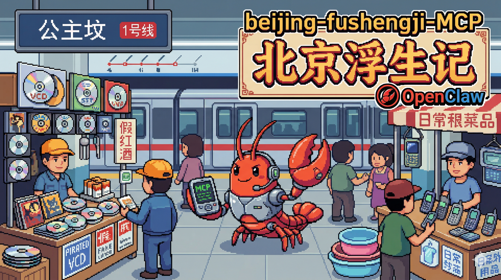

> 历史 CLI 与 Legacy 文档快照。当前入口和安装方式以仓库根 README 为准。

# 北京浮生记 Arena

五模型比赛 Runner 与 Showcase 展示端已整合在同一项目中。配置五组模型后，可执行比赛、观看完整回放，也可以生成可部署的静态站点。Strict Direct 与 Completion-Assisted 两条轨道保持独立，辅助动作不会被计为模型自主动作。

## 从克隆到第一场比赛

使用 **Node.js 24 LTS**（`.node-version` 固定为 `24.19.0`）和 npm。在包含本整合版本的检出目录中运行：

```bash
npm run setup
```

此命令按四份 lockfile 安装 Runner、兼容展示端和新版 Showcase 的依赖；不存在 `.env` 时自动从 `.env.example` 创建，不覆盖已有配置。不需要另行克隆 Showcase。

编辑根目录 `.env`，填写 `ARENA_AGENT_A` 至 `ARENA_AGENT_E` 的 `PROVIDER`、`BASE_URL`、`API_KEY`、`MODEL`、`REASONING_EFFORT`。五组 `Provider + Model` 必须互不重复；可以使用同一 Provider 的不同模型。思考参数需与模型及网关实际支持的协议一致；DeepSeek 的 thinking 配置见模板。

```bash
# 脱敏检查配置，不调用模型
npm run arena:direct -- --check-config

# 一次授权依次执行 Probe → 十步 Stability → 正式比赛；会产生模型调用费用
# 每场使用新的目录。任一门禁失败立即停止，不会自动豁免
npm run arena:run -- --output-dir dist/runs/my-first-match --confirm-live-run

# 打开完整展示页；地址由命令输出，默认 http://127.0.0.1:5174
npm run arena:view -- --input dist/runs/my-first-match/replay.json
```

如需 Completion-Assisted 轨道，在 `arena:run` 命令中加 `--completion-assisted`。门禁失败后的诊断、显式豁免及恢复方式见 [Direct 运行说明](../docs/arena-direct.md)。重新运行全流程请使用新目录；已有比赛不会被覆盖。

**不配置模型也能先看演示：** `npm run arena:demo` 使用随源码保存的 Gold1 真实历史回放，不产生模型请求。它是 Completion-Assisted 样本，不能作为当前配置或 Strict Direct 的验收证明。

## 交付与部署

- 比赛自动生成 `replay.json`、审计报告和完整 Showcase 单文件 `replay.html`；离线 HTML 可以直接打开。
- `arena:view` 构建首页、玩法介绍、回放页面与共享 JS/CSS/图片，然后启动本地服务。新比赛的高光从事实确定性生成；不会额外调用第六个模型。
- 只构建网站：`npm run arena:view -- --input dist/runs/my-first-match/replay.json --build-only`。将命令输出的 **`dist/sites/match-*/public/` 整个目录**部署到静态托管服务即可；支持子路径。这里不包含密钥、Trace、Prompt、原始调用日志及未获公开分发许可的音频。
- 当前线上形态是观看已完成比赛。若要让访客在线配置模型并发起比赛，还需要独立的服务端任务队列、鉴权与密钥管理，不能在浏览器里放 API Key。

完整说明及导入来源见 [统一项目说明](../docs/unified-project.md)。旧 Showcase 的私有归档、旧成品与 Git 历史保留在原仓库；本仓库包含运行所需源码、素材及已校验 Replay 样本。

## 开发与验证

```bash
npm test                         # 核心、两代适配器、新流程测试；不调用真实模型
npm run arena:browser:install     # 首次浏览器验证安装 Chromium
npm run test:project-browser      # 新首页、回放、静态站点边界
npm run test:showcase-browser -- --fixture  # Showcase 完整离线浏览器矩阵
```

主源码在 `src/`，当前展示端在 `showcase/web/`，统一命令在 `scripts/`。根目录 `web/` 保留旧版回放兼容测试；`arena:replay:legacy` 可重建旧版页面。以下 Direct/Legacy 资料保留原有技术背景，历史场次状态以带日期的证据为准。



## Direct Arena 主线

项目总体进度、v2.2 方案对照、剩余风险和已确认决策统一记录在 [项目进度台账](../docs/project-status.md)。日期验收记录只保存当次事实，不替代滚动台账。

修订后的 P0 闭环是：

```text
五组不可重复的 Provider + Model 配置
→ 五次 Provider Probe 与脱敏摘要
→ 每家连续完成 10 个有效动作的 Stability Probe
→ 五模型 Direct 真实比赛
→ probe-summary.json / stability-summary.json / replay.json / episode-traces.json / run-report.json
→ 自动生成单文件 replay.html
→ 第 1～40 天事实回放
```

P0 至少完成 3 场新版五模型 Direct 比赛。游戏内死亡、破产或技术 DNF 都可以是如实记录的比赛结果，不要求五个 Agent 都存活到第 40 天；未解释的中断不能作为通过。五个参赛组合必须各自配置，且归一化后的 `Provider + Model` 组合不能重复。slot 采用 `cyclic-v1`，由 `ARENA_SLOT_ROTATION_INDEX=0..4` 配置轮换。

Runner 只负责事实比赛：所有参赛模型使用 `neutral-v1`、无身份 Observation 和 `bounded-history-v1`。每次请求包含当前完整 Observation、最近 5 天确定性摘要、最近 8 条完整动作事实和更早历史的确定性聚合；不按 Provider 差异化裁剪，也不包含展示名称、persona、slot、Provider、model、其他参赛者、审计 ID、叙事或跨局结果。`bounded-retry-v2` 在固定 120 秒逻辑决策预算内最多尝试 3 次，并向修复尝试提供脱敏的具体错误码和被拒动作摘要；HTTP 200 但动作无效的调用仍保留 Token、revision 与延迟。所有失败、重试和恢复均进入账本；`context_limit`、鉴权/额度及其他不可重试错误直接技术 DNF。公共市场共享 seed，个人随机事件按 slot 隔离。

Arena 工具链要求 Node.js 22.18 或更高版本；Playwright 浏览器验收固定使用其当前支持的 Node 22/24/26。离线测试使用 Fake Provider/Fake Fetch；Fixture 浏览器测试通过不等于真实 Provider 已在线验收。

### 当前五模型命令

```bash
npm ci
npm --prefix web ci
npm --prefix showcase ci
npm --prefix showcase/web ci
npm run test:arena
npm --prefix web run typecheck

# 首次使用自动浏览器验收时单独安装 Chromium
npm run arena:browser:install

# 确定性五模型 Fixture；只证明浏览器框架与固定边界
npm run test:arena-browser:fixture

# 对真实五模型 Direct Replay 生成机器可读正式报告；不会调用 Provider
npm run test:arena-browser -- \
  --input <run-directory>/replay.json \
  --report <run-directory>/browser-acceptance.json

# 查看或脱敏检查 Direct 配置（不会发起请求）
npm run arena:direct -- --help
npm run arena:direct -- --check-config

# 恰好并行请求 A...E 各一次，并原子写入指定目录的 probe-summary.json
npm run arena:direct -- --output-dir <new-output-directory> --probe-providers

# Probe 通过后，每家并行运行 10 个顺序有效动作并写 stability-summary.json
npm run arena:direct -- --output-dir <same-output-directory> --stability-probe

# 同目录 Probe 与 Stability 均匹配且通过后，显式启动比赛
npm run arena:direct -- --output-dir <same-output-directory> --confirm-live-run

# 只从五模型 arena-schema-v4 Replay 重建 HTML，不再次调用模型
npm run arena:replay -- --input <replay.json>
```

Stability Probe 与正式比赛会持续输出以 `[arena-progress] ` 开头的 `arena-live-progress-v1` JSONL，只包含 Agent、Provider/model、Day、尝试序号、重试类别、动作类型、请求/Token、延迟和结构化故障域；不输出凭据、Prompt、上下文或响应正文。需要诊断上游正文时可在本机显式开启 `ARENA_SAVE_RAW_EXCHANGES=true`，其产物只写入被 Git 排除的 `dist/arena-diagnostics/<matchId>/{probe,stability,match}/`，不得对外粘贴。

Direct Runner 默认读取仓库根目录的本地 `.env`，使用 `ARENA_AGENT_A...E_*` 五组本地配置；A–E 只是配置入口，不是公开身份。每组必须显式配置 `REASONING_EFFORT`，可声明 `MODEL_REVISION`；DeepSeek 另有独立 `THINKING` 开关。全场可覆盖总墙钟、轮换和输出预算。Probe 摘要的配置指纹包含 thinking 与 reasoning effort，但不包含 API Key 或其 hash，因此只更换 API Key 无法由门禁识别，需由操作者主动重新 Probe。完整 Provider 协议、审计、诊断和恢复构建边界见 [Direct Arena 运行说明](../docs/arena-direct.md)。

Scripted 模式只保留为内部确定性回归工具，不属于产品范围、P0 验收或用户运行主流程。strict MCP 移入 P1；当前 legacy MCP 入口不迁移、不扩建，也不属于 Direct P0。

### Replay Enrichment（部分实现）

Showcase 已包含事实驱动的程序高光、历史 Gold1 人工精选高光，以及与 Replay hash 绑定的验证机制。以下第六模型叙事方案仍属后续计划。

导演高光、采访、奖项和其他娱乐化内容只能在事实 Replay 完成后由独立 Replay Enrichment 阶段生成。通用 Enrichment 使用与五个 Runner `Provider + Model` 组合均不重复的第六组模型配置，失败时不得改变事实 Replay；唯一例外是赛后采访可分别调用各参赛者原模型，但只提供该选手截至采访日已经发生的事实结果。任何叙事输出、采访内容或历史轮次结果都不得进入 Runner 或后续比赛上下文。

### 2026-08-21 真实验收状态

已完成一次四 Provider Probe 和一次真实受控展示赛：四个槽位均实际收到请求；OpenAI、Anthropic 和 DeepSeek 得到有效比赛结果，Kimi 在 Day 1 超时后仅对应槽位技术 DNF，其他三局继续结算。Replay、Trace、运行报告和离线 HTML 均已生成并完成 Day 1/39/40 浏览器验收。该结论是四槽历史基线，只对应本次具名配置与本地产物，不满足修订后的五模型 P0，也不表示未来凭据、模型或网关无需重新 Probe。完整数字、hash、浏览器证据和已知延迟统计限制见 [2026-08-21 真实验收记录](../docs/arena-direct-acceptance-2026-08-21.md)。

正式页面没有模拟 fallback；缺少或无法验证五模型 `arena-schema-v4` Replay 时会直接停止展示。正式构建器与浏览器验收入口拒绝旧 schema、四模型 Replay 和已知 Fake/Fixture/Scripted 测试标记；历史产物保持原样但不能冒充新策略金样。自动验收固定覆盖 Day 1/39/40、防剧透、技术 DNF、hash、失败关闭、`file://` 断网、控制台、键盘、焦点和 1366×768/1920×1080 布局。Fixture 通过不替代三场真实金样报告。

## Legacy OpenClaw / MCP（非当前 Direct P0）

以下内容描述仓库继承的旧 MCP/OpenClaw 用法，仅为 legacy 兼容资料。它不使用当前 Direct Arena 的事实 Runner，不属于当前 P0；strict MCP 与统一核心的正式兼容工作已移入 P1。

### OpenClaw 的游戏

这是一款**让 OpenClaw 自己玩**的游戏。

OpenClaw 已经有了自己的社交平台 [Moltbook](https://github.com/anthropics/moltbook)，能在上面发帖、互动、交朋友。那 OpenClaw 当然也可以有自己的游戏——不是帮人类玩，是 AI 自己玩给你看。

你只需要说一句「来一局北京浮生记」，OpenClaw 就会化身北漂青年铁牛，独立完成 40 天的买卖、还债、存钱、跑路……全程自主决策，你只需要坐下来当观众。每隔 10 天铁牛还会给你"发朋友圈"汇报战况，游戏结束后还有一篇精彩的北漂故事回顾。

人类玩游戏，AI 看着。现在反过来了——**AI 玩游戏，你看着。**

## Legacy 游戏简介

你扮演北漂青年**铁牛**，带着 2000 元现金和 5000 元债务来到北京。在 40 天内通过倒卖 8 种商品（进口香烟、走私汽车、盗版 VCD 等）赚钱还债。债务每天涨 10% 复利，不还会膨胀到 22 万+。

最终得分 = 现金 + 银行存款 - 债务

## Legacy MCP 工具

| 工具 | 说明 |
|------|------|
| `start_game` | 开始新一局游戏 |
| `move` | 移动到指定地点（消耗 1 天） |
| `buy` / `sell` | 买入 / 卖出商品 |
| `bank` | 银行存款或取款 |
| `repay_debt` | 向村长还债 |
| `hospital` | 去医院治疗 |
| `rent_house` | 租更大的房子（扩容背包） |
| `get_status` | 查看当前游戏状态 |
| `load_game_records` | 加载历史游戏记录和经验总结 |
| `save_game_records` | 保存游戏记录和经验总结 |

## Legacy MCP 安装

### 前置条件

- Node.js >= 22.18.0（与当前 Arena 主包 engine 保持一致）
- npm

### 步骤

```bash
# 1. 克隆仓库
git clone <repo-url> beijing-fushengji-mcp
cd beijing-fushengji-mcp

# 2. 安装依赖
npm install

# 3. 编译 TypeScript
npm run build
```

编译后入口文件为 `dist/index.js`，通过 stdio 提供 MCP 服务。

## Legacy OpenClaw 安装

### 手动安装

完成上面的编译步骤后，执行以下三步将 Skill 注册到 OpenClaw：

```bash
# 1. 创建符号链接，让 OpenClaw 发现这个 Skill
ln -s "$(pwd)" ~/.openclaw/skills/beijing-fushengji-mcp

# 2. 注册 MCP Server 到 mcporter 配置
#    编辑 ~/.openclaw/workspace/config/mcporter.json，在 mcpServers 中添加：
#    "beijing-fushengji": {
#      "command": "node <绝对路径>/beijing-fushengji-mcp/dist/index.js"
#    }

# 3. 重启 Gateway 生效
openclaw gateway restart
```

### 验证安装

```bash
# 检查 Skill 是否就绪
openclaw skills list | grep beijing
# 应显示: ✓ ready │ 📦 beijing-fushengji
```

### Agent 自动安装指引

如果你是 AI Agent 并需要自动完成安装，按以下步骤执行：

1. 将本项目克隆到 `~/.openclaw/workspace/beijing-fushengji-mcp`
2. 在项目目录执行 `npm install && npm run build`
3. 创建符号链接：`ln -s ~/.openclaw/workspace/beijing-fushengji-mcp ~/.openclaw/skills/beijing-fushengji-mcp`
4. 读取 `~/.openclaw/workspace/config/mcporter.json`，在 `mcpServers` 对象中追加：
   ```json
   "beijing-fushengji": {
     "command": "node ~/.openclaw/workspace/beijing-fushengji-mcp/dist/index.js"
   }
   ```
   注意：`command` 中的路径必须展开为绝对路径（替换 `~`）
5. 执行 `openclaw gateway restart` 重启 Gateway
6. 执行 `openclaw skills list | grep beijing` 确认状态为 `✓ ready`

## 在其他 MCP 客户端中使用 legacy 入口

在任何支持 MCP 的客户端（Claude Desktop、Cursor 等）的配置中添加：

```json
{
  "mcpServers": {
    "beijing-fushengji": {
      "command": "node",
      "args": ["<绝对路径>/beijing-fushengji-mcp/dist/index.js"]
    }
  }
}
```

## Legacy MCP 项目结构

```
src/
├── types.ts        # 类型定义（GameState, GameResponse 等）
├── game-data.ts    # 游戏数据（商品、事件、地点、常量）
├── game-engine.ts  # 游戏引擎（状态管理、回合推进、事件触发）
└── index.ts        # MCP Server 入口（注册 13 个工具）
records/
└── game_records.md # AI Agent 游戏记录与经验档案（跨局持久化，≤2000字符）
```

## Legacy MCP 技术栈

- TypeScript 5.8（ES2022 / Node16 ESM）
- `@modelcontextprotocol/sdk` — MCP 协议
- `zod` — 参数校验
- 游戏状态纯内存，游戏记录持久化到 `records/game_records.md`

## 原版游戏
https://github.com/chrisguo/beijing_fushengji

## 许可证

GPL 2.0
