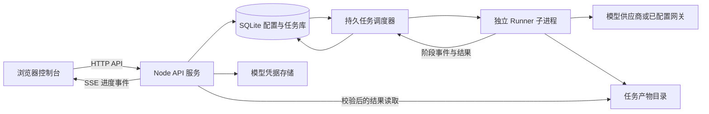

# Arena Web 应用改造方案

日期：2026-11-11。本文保留改造设计。首版 Web 应用已实现，实际入口、部署与边界见 [Web 应用运行说明](web-app.md)。目录迁移采用增量方式，已有核心和回放源码通过公共服务复用；HTML 导出继续由 CLI 提供，Web 直接导出 JSON。以下接口与结构是设计目标，实际支持范围以运行说明为准。

## 1. 产品目标

将项目改造成持续运行的 Web 应用：用户在浏览器中配置模型、创建和管理 Bench 任务，后端执行比赛并保存结果，前端展示运行进度、结果分析和完整回放。

用户已确认第一版用于自己或小团队，采用单实例部署。默认一场 Bench 同时运行，场内沿用五模型并行；后续根据供应商配额增加任务并发。公开注册、多租户独立计费及分布式调度不进入第一版。

用户的完整流程：

```text
启动服务 → 打开控制台 → 添加模型连接和模型配置
→ 创建任务、选择五个模型 → 确认启动
→ 查看排队与执行进度 → 查看结果分析和回放
→ 复制配置再跑一场 / 归档任务 / 导出结果
```

模型凭据由前端录入、后端保存与使用。`.env` 只保留服务部署参数，日常操作不再需要编辑模型环境变量、执行比赛命令或查找输出目录。

## 2. 与当前工程的关系

| 能力 | 当前证据 | 改造方式 |
| --- | --- | --- |
| 游戏规则与事实回放 | `src/core/`，确定性规则、事件、hash | 原样复用，迁入核心包 |
| 模型调用 | `src/arena/providers/`，六类 Provider 标识及适配器 | 复用调用协议，配置来源改为任务快照 |
| 比赛编排 | `src/arena/match-runner.ts` 的 `runMatch()` | 提供后端调用入口，保留五模型约束 |
| 门禁与报告 | Probe、Stability、Run Report 已实现 | 从 CLI 的流程编排中抽出服务层 |
| 运行进度 | `onProgress` 回调与 `arena-live-progress-v1` | 转为持久任务事件，经 API 推送给前端 |
| 取消任务 | 单次调用支持 `AbortSignal`；Match/Episode 尚无外部任务取消入口 | 补齐任务级取消信号，贯穿门禁、模型调用、退避等待和产物写入 |
| 回放界面 | `showcase/web/`；从 HTML 脚本节点读 Replay | 保留适配器校验与组件，增加按任务 ID 请求数据的入口 |
| Bench 分析 | `BenchPage.tsx` 导入历史 Gold 汇总和人工策略点评 | 改为本任务数据；历史点评仅属于原样本，不能套在新任务上 |
| 模型列表查询 | `tools/model-list-query/` 兼容部分 Models API | 提取查询能力到后端；保留手动填写模型 ID |
| 项目组织 | 四份安装入口、两个展示目录、文件式产物 | 单一 workspace、统一 Web 入口、数据库＋独立数据目录 |

已有测试是迁移基线。此前“统一源码仓库”的工作继续保留；这次进一步定义应用层和服务运行方式。

## 3. 前端信息结构

| 页面 | 主要操作和展示 |
| --- | --- |
| 任务中心 `/tasks` | 新建任务；按状态、时间、轨道筛选；显示排队、执行阶段、五模型进度；进入结果 |
| 新建任务 `/tasks/new` | 名称、五个模型配置、Strict/Assisted、seed、轮换、超时、请求及输出预算；保存草稿、启动 |
| 任务详情 `/tasks/:id` | 概览、模型与参数快照、阶段进度、脱敏事件、失败原因；取消、复制为新任务、归档 |
| 结果分析 `/tasks/:id/results` | 排名、净资产、退出原因、耗时、请求数、Token、失败和重试、辅助动作；区分轨道与缺失数据 |
| 回放 `/tasks/:id/replay` | 复用现有舞台、Day 1–40、排名、事实动作和高光；回到对应任务 |
| 模型管理 `/models` | 管理连接和模型配置；获取模型列表、手动输入模型 ID、显式测试、启用或停用 |
| 设置 `/settings` | 任务并发和默认预算、存储占用、导出与备份说明、服务版本 |

控制台采用常规表格、表单、状态标签和图表。比赛回放保留现有视觉风格。进入项目默认看到任务中心；已完成任务也可以直接打开回放链接。

运行中显示每个模型的实际游戏日、调用状态与请求数；不伪造统一完成百分比或剩余时间。第一版提供运行监控，正式回放在完整 Replay 通过校验后开放；实时观战留到后续。

## 4. 后端结构与部署形态



第一版采用现有 React/Vite 前端和 Node/TypeScript 后端。API、调度器在一个后端应用中运行，执行比赛时启动独立的已编译 Runner 子进程；通过结构化消息传递配置、进度和结束结果。API 请求只入队，不等待比赛结束。

使用 SQLite 保存配置、队列与事件，本地文件系统保存 Replay 和报告；暂不引入 Redis 或独立消息队列。调度器用事务领取任务，并记录执行租约和心跳，防止重复领取。数据库是任务状态的权威来源，内存只保存活动子进程句柄。

生产环境前后端同源，由后端提供构建后的前端静态文件和 `/api`。本地开发时 Vite 代理 `/api`。服务端调用模型，浏览器不直接访问模型供应商。

单实例部署保存两个持久对象：应用数据库与任务文件、密钥材料。第一版提供本地 Node 启动方式和单实例容器部署方式；访问公网时配置 HTTPS 与登录保护。增加多实例前，再迁移任务领取、存储和租约实现。

## 5. 配置与数据模型

### 模型配置

将供应商连接与模型参数分开，避免同一个 Key 在五个槽位重复填写。

- **连接**：名称、Provider/协议类型、Base URL、凭据引用、是否启用、测试时间和结果。同一连接可配置多个模型。
- **模型配置**：连接 ID、模型 ID、thinking、reasoning effort、输出 Token 上限、可选 revision。支持同一模型的多份参数预设。
- **任务配置快照**：启动时固定五份模型配置、连接版本、凭据版本引用、轨道、seed、轮换、预算、引擎版本。快照不包含明文密钥。

延续现有规则：一场恰好五个不同的、归一化后的 `Provider + Model` 组合；同一模型的不同参数预设仍算同一组合。第一版不顺带修改比赛规则、上下文策略或失败语义。

保存配置只做本地格式检查。获取模型列表和测试连接是独立的显式操作；模型列表不可用时允许手工填写。连接测试结果不替代正式任务的 Probe/Stability。模型是否支持某个参数，以既有适配器校验及实际测试结果为准，不因列表里存在模型就推定可运行。

修改模型配置不影响已排队或运行的任务；凭据轮换生成新版本，旧版本在被活动任务引用期间保留。管理员明确撤销凭据时，相关未完成任务停止或失败并记录原因，不能偷偷切换到另一个 Key。

### 持久记录

| 记录 | 关键内容 |
| --- | --- |
| `connections` / `connection_versions` | 连接信息、版本、启停状态及密钥引用 |
| `model_profiles` / `model_profile_versions` | 可选择的模型参数预设及版本 |
| `tasks` | 名称、状态、阶段、启动时间、结束时间、排队信息、当前执行 ID |
| `task_snapshots` | 本次不可变参数、模型/凭据版本引用、引擎版本；不含明文凭据 |
| `executions` | 一次执行的 ID、任务 ID、心跳、租约、退出原因和取消状态 |
| `task_events` | 递增事件序号、阶段、时间及脱敏进度，用于重连补发 |
| `artifacts` | 所属执行、类型、服务端路径、schema、hash、是否可供查看 |
| `task_results` | 从已校验事实与报告派生的查询摘要；可重建，不替代事实文件 |

对模型配置、启动、取消、凭据撤销和归档记录操作者及时间。第一版仅面向可信管理员；若改为开放多用户，需要补充所有记录的归属、资源权限和配额隔离。

## 6. 任务生命周期

状态和执行阶段分别保存，避免把“Probe 失败”和“比赛完成但模型破产”混为一谈。

```text
draft → queued → running → succeeded
                  ├─────→ failed
                  ├─────→ cancelling → cancelled
                  └─────→ interrupted

queued → cancelled
阶段：validate → probe → stability → match → finalize
```

- **启动**：校验并固化快照，原子入队；请求使用幂等键，重复点击不创建两次付费执行。页面明确本次会执行 Probe、Stability 和 Match。
- **门禁失败**：任务失败，展示哪个模型、哪个阶段失败；不自动豁免。第一版界面不提供 waiver，已有 CLI 高级流程继续保留，历史 waiver 如实展示。
- **比赛完成**：只要完整事实产物合法，模型的自然死亡、破产或技术 DNF 都是比赛结果，任务可以成功。技术 DNF 不因此获得正常比赛名次。
- **取消**：排队任务直接取消；运行任务先中止后续决策、在途请求和退避等待，超出退出期限再结束子进程。取消不等价于已发送请求不计费，也不回填正常比赛结果。
- **异常退出**：Worker 心跳丢失、服务重启或退出前没提交完成标记，任务记为 `interrupted`；不自动重放付费步骤。排队任务持久保留，可在服务恢复后继续排队。
- **重跑**：复制参数创建新任务、新执行和新目录；重新运行门禁。保留与原任务的来源关系，不覆盖旧数据。
- **发布结果**：在私有暂存区完成 Replay/Report 校验后，发布产物清单并更新结果可用状态。崩溃恢复根据清单和执行 ID 对账，不因发现一个 JSON 文件就宣告成功。
- **导出失败**：不把成功比赛变成失败任务；可选导出使用独立状态，只重试导出，不重新调用模型。
- **归档**：只隐藏终态任务，可恢复。永久删除数据是单独操作，运行中不可删除；第一版不做自动清理历史任务。

第一版不提供暂停、从第 N 天恢复或自动续跑。这些能力需要可验证的状态检查点，当前 Runner 尚未实现。取消后的进度事件可查看，但不包装为完整的正式 Replay。

SSE 使用持久事件序号；刷新或断线后按 `Last-Event-ID` 补发，必要时重新获取任务快照。关闭浏览器不影响后端任务；推送断线也不能阻止 Runner 继续执行。

## 7. API 边界

以下为拟定接口，尚未实现。

| 接口 | 用途 |
| --- | --- |
| `GET/POST /api/connections`、`PATCH /api/connections/:id` | 管理连接，返回结果只包含脱敏凭据状态 |
| `POST /api/connections/:id/models:refresh` | 服务端查询模型列表，失败不妨碍手动填写 |
| `POST /api/model-profiles/:id/test` | 显式测试模型配置，不启动完整比赛 |
| `GET/POST /api/model-profiles`、`PATCH /api/model-profiles/:id` | 管理模型预设与版本 |
| `GET/POST /api/tasks`、`PATCH /api/tasks/:id` | 列表、创建草稿、修改未启动配置 |
| `POST /api/tasks/:id/start` | 固化快照并入队，幂等处理 |
| `GET /api/tasks/:id`、`GET /api/tasks/:id/events` | 读取任务快照、SSE 进度 |
| `POST /api/tasks/:id/cancel`、`POST /api/tasks/:id/clone` | 取消、复制为新的任务草稿 |
| `POST /api/tasks/:id/archive`、`POST /api/tasks/:id/restore` | 归档、恢复终态任务 |
| `GET /api/tasks/:id/results` | 本任务结构化分析摘要 |
| `GET /api/tasks/:id/replay`、`GET /api/tasks/:id/enrichment` | 获取校验后的事实与高光；结果未就绪返回明确状态 |
| `POST /api/tasks/:id/exports`、`GET /api/exports/:id` | 异步导出单文件或结果包并查询状态 |

客户端只传配置字段和资源 ID，不能传 shell 命令、任意输出路径或环境变量。错误返回稳定错误码、可读说明、阶段和任务 ID；不返回上游原始正文。

API Key 经表单提交后保存在后端加密凭据库；读取配置只返回“已配置”和掩码，不返回原文，不写 localStorage。解密密钥独立于数据库保存：本地首次启动可在私有数据目录生成、限制文件权限；服务器通过受控配置或独立持久卷提供，备份时明确两者缺一不可。

本地默认监听回环地址。远程部署需管理员登录、同源会话及写操作 CSRF 防护；模型连接仅由管理员配置。自定义网关保留，但后端应校验协议、重定向和目标地址；需要访问内网模型时由实例管理员明确配置允许范围，避免将连接测试变成任意网络代理。

## 8. 回放与 Bench 数据改造

前端在发布应用时构建一次。完成一场任务后，后端只增加数据，不运行 Vite，也不把图片复制到每个任务目录。

回放页使用任务 ID 拉取 `replay.json`，交给既有 `adaptCoreMatchReplay()` 验证 schema/hash，再构建可见日期切片。高光独立加载，失败只降级高光，不修改事实。原 HTML 注入读取方式保留在离线导出适配层。

Bench 分析由本次 Replay、Run Report 和门禁报告生成。沿用失败、重试、用量缺失、Strict/Assisted 及 waiver 的真实口径。Provider 未报告 Token 的调用标为缺失；无定价依据时不显示虚构的人民币费用。

第一版完成单任务分析。跨任务比较、批量 seed/rotation、排行榜在后续阶段实现，必须展示规则版本与参数差异；历史人工策略解读单独标注为策划内容。

历史样本通过“导入已完成比赛”路径注册为只读结果，记录来源和 hash，不伪装成本服务刚执行的任务，也不自动生成对应的真实模型凭据。

## 9. 目录与体积整理

建议使用 npm workspaces 和一份根 lockfile。下列是目标结构，尚未搬迁：

```text
apps/
  web/                 # 控制台、结果分析、回放
  server/              # API、配置库、调度器、静态资源服务
  cli/                 # 自动化和高级诊断入口，共用同一 Runner
packages/
  contracts/           # 浏览器与后端共享的类型和 API 契约
  core/                # 游戏规则、确定性状态与事实契约
  runner/              # Provider、Probe、Stability、比赛执行与报告
  replay/              # 回放校验、适配、日期切片和事实高光
  export/              # 可选 HTML/结果包导出
assets/runtime/        # 一份运行图片和资源清单
examples/              # 小型演示样本；大型历史样本按需获取
legacy/mcp/            # 兼容入口，不进入主应用运行链
docs/
tests/
var/                   # 数据库、密钥材料、任务文件；Git 忽略
```

迁移映射：`src/core` → `packages/core`；`src/arena` → `packages/runner`；CLI 编排 → `apps/cli` 与 Runner 服务；`showcase/web` → `apps/web`；回放数据处理抽到 `packages/replay`。共享契约不能依赖 Node 专属模块或服务端密钥代码。

先完成新应用关键路径验证，再移除旧 `web/` 的生产入口及重复资源；需要保留的旧版兼容测试转入专门目录。不能仅通过改目录名把两套构建系统都保留下来。

体积治理作为单独可核验的工作：

1. 对照资源 manifest 和实际引用，区分运行图、设计原图、QA 截图与私有音频；先去除无引用文件，再压缩实际运行图。
2. 相同素材只保存一份，首页和回放共享；只读历史大样本和设计原稿移至带 hash 清单的独立资料包，日常运行不依赖它们。
3. 素材提示词、原始设计稿和 QA 截图不参与前端构建；私有音频不进入默认线上部署包。
4. 任务产物保存在 `var/` 或配置的数据卷，不能进入源码、Git 或前端静态目录。首次安装不下载历史归档。
5. 以当前已跟踪文件约 134.5 MiB 为体积基线；整理后报告源码、运行资源、部署包与完整 Git 历史各自大小，不能混算。
6. 普通提交完成工作树瘦身。Git 历史重写单独评估和授权，不默认强推、不删除原仓库和历史记录。

## 10. 开发顺序与验收

| 阶段 | 工作 | 完成标准 |
| --- | --- | --- |
| M1 应用骨架与运行入口 | workspaces、共享契约、Server、SQLite 迁移、数据目录、配置库和后台 Worker；抽出 CLI 中的门禁编排 | 无前端构建依赖也能从服务层运行 Fake Bench；干净安装、数据库初始化、旧 CLI 回归通过 |
| M2 模型管理与任务闭环 | 连接/模型表单、任务草稿/列表/详情、入队、配置快照、SSE、取消和重启对账 | 只用浏览器完成配置→运行→观察进度；刷新继续显示；取消停止后续请求；重复启动不重复执行 |
| M3 动态结果与回放 | 将 Showcase 组件接到任务 API，生成本场 Bench 摘要，隔离历史人工点评；按需导出 | 两个不同任务展示各自数据；新增比赛不重新构建前端；故意损坏 Replay 时失败关闭；导出失败不重跑比赛 |
| M4 发布与瘦身 | 登录和部署配置、单实例容器、备份恢复、素材整理、旧入口退役、文档与 CI | 新机器克隆后启动，浏览器配置模型即可运行；服务器重启不丢任务；恢复备份后可查看旧结果；记录体积变化 |

M1–M3 优先做完整纵向路径，跑通后再做大规模资源搬移。每个阶段以 Fake Provider 验证；真实付费调用只在明确发起的测试或任务中进行。现有 154 项测试和浏览器基线按迁移保留或等价迁移，不能用新的少量页面测试替代核心规则回归。

重点验收场景：配置更新不改变排队任务、密钥不出现在接口/日志/产物、重复点击启动、取消发生在退避中、Worker 崩溃、服务重启、SSE 重连、门禁失败、完整比赛含 DNF、结果发布中途崩溃、导出重试、两场结果串读、历史样本导入、子路径访问。

## 11. 目标交付体验

以下命令是改造后的目标，当前尚未提供对应应用：

```bash
git clone <repository>
cd beijing-fushengji-arena
npm ci
npm run dev
# 打开控制台，在页面添加连接和模型，创建并启动任务
```

生产运行目标是 `npm run build && npm start`，或通过容器编排启动并挂载数据卷。主分支达到可用里程碑后，README 切换到此入口；当前可执行的 CLI 命令在改造完成前继续保留。

最初方案轮次仅整理设计；随后用户同意实施，已完成单实例应用的核心闭环。没有重写 Git 历史或运行真实 Bench；详细实现和未覆盖项见运行说明。
